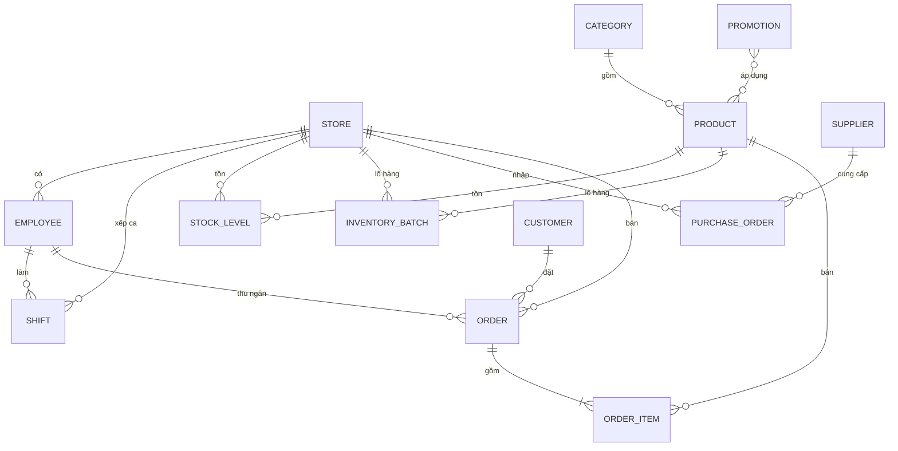

# Kiến trúc

Tài liệu cho cả nhóm (FE + BE). Tổng quan dự án: [`../README.md`](../README.md).

## 1. Tổng quan

```text
Trình duyệt
 ├─ Cửa hàng online  (/, /danh-muc, /san-pham, /gio-hang, /tai-khoan …)
 └─ Quản lý          (/quan-ly/…)
        │  cùng một ứng dụng Next.js (apps/frontend)
        ▼
 Tầng dữ liệu hiện tại: "backend giả" chạy trong trình duyệt
   src/stores/db.ts  ── lưu IndexedDB, đồng bộ giữa các tab
   src/lib/seed.ts   ── sinh dữ liệu mẫu 35 ngày (đơn, tồn kho, ca làm…)
        │
        ▼  (sau này)
 Backend thật (apps/backend) ── REST API + cơ sở dữ liệu
```

Vì chưa có backend, mọi màn hình đọc/ghi qua `useDb` (zustand). Các **action** của store
(`placeOrder`, `receivePurchaseOrder`, …) chính là danh sách API backend cần làm; khi có
backend chỉ cần thay phần thân action bằng lời gọi HTTP, giao diện giữ nguyên.

## 2. Frontend

| Lớp | Vị trí | Vai trò |
| --- | --- | --- |
| Trang | `src/app/(shop)`, `src/app/quan-ly` | Route theo tiếng Việt, layout riêng cho cửa hàng / quản lý / POS |
| Component dùng chung | `src/components/{shop,admin,brand,ui}` | Thẻ sản phẩm, header, bảng dữ liệu, thẻ số liệu, shadcn/ui |
| Nghiệp vụ thuần | `src/lib` | Tính giá & khuyến mãi, hạng thành viên, phân quyền, trạng thái, định dạng |
| State | `src/stores` | `db` (dữ liệu), `session` (đăng nhập), `cart` (giỏ hàng), `admin-ui` (cửa hàng đang xem) |
| Hợp đồng dữ liệu | `src/types/index.ts` | Kiểu dữ liệu dùng chung FE ↔ BE |

Quy tắc nghiệp vụ quan trọng đều nằm trong `src/lib` dưới dạng hàm thuần để backend chép lại:

- **Tính giá** (`pricing.ts`): flash sale theo khung giờ → mua X tặng Y → voucher đồ uống theo
  hạng (tối đa 3 ly/đơn) → mã giảm giá (đơn tối thiểu, hạng, kênh, lượt dùng) → phí giao
  15.000 ₫, miễn phí từ 100.000 ₫ (đủ để bù phí giao ở biên lợi nhuận ~27%).
- **Hạng thành viên** (`membership.ts`): Đồng → Bạc (tích luỹ 1 triệu) → Vàng (3 triệu) → Kim cương
  (5 triệu). Chi tiêu tính sau mọi giảm giá, không tính đồ uống có cồn; đủ mốc là lên hạng ngay. Ngày 1
  hằng tháng xét chi tiêu tháng trước: dưới mức giữ hạng (Bạc 200.000 ₫, Vàng 350.000 ₫, Kim cương
  500.000 ₫) thì xuống 1 hạng và chi tiêu tích luỹ về đúng mốc hạng mới; tháng vừa lên hạng không bị xét.
- **Sao vàng** (`stars.ts`): 45.000 ₫ = 1 sao, phần lẻ cộng dồn, sao có hạn 12 tháng; đổi sao lấy voucher
  riêng (`Promotion.ownerId`), hạn 30 ngày. Nghiên cứu: [`research/chuong-trinh-thanh-vien.md`](research/chuong-trinh-thanh-vien.md).
- **Cửa hàng phục vụ & vùng giao** (`geo.ts` + `storeForAddress` trong `stores/cart.ts`): đơn online
  được giao từ cửa hàng **đang hoạt động gần địa chỉ nhất** (đường chim bay, công thức haversine).
  Quá `DELIVERY_RADIUS_KM` (5 km) thì **không cho đặt giao hàng** — lời hứa "giao 24 phút" chỉ đúng
  trong tầm đó. Địa chỉ chỉ có toạ độ khi khách bấm "dùng vị trí hiện tại"; không có toạ độ thì lấy
  cửa hàng đầu tiên trong cùng tỉnh/thành và không chặn theo khoảng cách.
- **Đổi toạ độ thành địa chỉ** (`geocode.ts`): bấm "dùng vị trí hiện tại" sẽ gọi Nominatim
  (OpenStreetMap, miễn phí) để điền lại tỉnh / phường / đường, nên chữ khách gõ và vị trí thật không
  chỏi nhau. Đây là **dịch vụ ngoài duy nhất** cả ứng dụng gọi; hỏng mạng thì giữ nguyên chữ đã gõ.
  Bản thật nên cho backend gọi và lưu đệm thay vì gọi thẳng từ trình duyệt.
- **Giao hàng** (`delivery.ts`): nhân viên cửa hàng tự giao, không thuê sàn — chi phí giao nằm trong
  lương chứ không tính theo đơn. Thời gian giao = 8 phút soạn hàng + 4 phút mỗi km, tối thiểu 24 phút.
  Đơn ghi lại nhân viên giao (`DeliveryInfo.shipperId`) và quãng đường.
- **Phân quyền** (`permissions.ts`): ma trận vai trò × phân hệ, mức `view` / `manage`.
- **Trạng thái đơn** (`order-status.ts`): online `pending → confirmed → preparing → delivering
  → completed`, huỷ được khi chưa giao; đơn tại quầy tạo ở trạng thái `completed`.
- **Số liệu báo cáo** (`analytics.ts`): doanh thu = tổng tiền đơn không huỷ; lợi nhuận gộp =
  Σ (thành tiền dòng − giá vốn × số lượng); kỳ so sánh = cùng số ngày liền trước (hôm nay tính
  đến cùng giờ).

## 3. Mô hình dữ liệu



Chi tiết từng trường nằm trong `apps/frontend/src/types/index.ts`. Quy ước: tiền là số nguyên
VND, thời gian là chuỗi ISO-8601, `id` là chuỗi.

## 4. Bàn giao cho backend

Mỗi action của `src/stores/db.ts` tương ứng một API. Gợi ý REST (nhóm BE có thể đổi, nhưng
giữ nguyên dữ liệu vào/ra theo `src/types`):

| Action FE | API gợi ý | Ghi chú |
| --- | --- | --- |
| đọc `products`, `categories` | `GET /api/products`, `GET /api/categories` | lọc `?category=&q=&active=` |
| `saveProduct` | `POST /api/products`, `PUT /api/products/:id` | tạo tồn kho 0 cho mọi cửa hàng khi thêm mới |
| `setProductActive` | `PATCH /api/products/:id` | |
| đọc `stock`, `batches` | `GET /api/stores/:storeId/stock`, `GET /api/stores/:storeId/batches` | |
| `adjustStock`, `setStockLevel` | `PATCH /api/stores/:storeId/stock/:productId` | ghi lý do điều chỉnh |
| `discardBatch` | `POST /api/batches/:id/discard` | xuất huỷ, trừ tồn |
| `placeOrder` | `POST /api/orders` | **server tự chọn cửa hàng gần địa chỉ giao nhất** (chỉ cửa hàng đang hoạt động), **tự tính giá** theo `pricing.ts`, trừ tồn, trừ lô theo hạn dùng sớm nhất trước (FIFO); khách thành viên: ghi `memberSpend`, cộng chi tiêu tích luỹ (lên hạng ngay nếu đủ mốc), cộng sao (`starsEarned`) và ghi sổ sao |
| `updateOrderStatus` | `PATCH /api/orders/:id/status` | huỷ thì hoàn tồn, hoàn tiền nếu đã trả, trừ lại chi tiêu tích luỹ và sao của đơn |
| `redeemStars` | `POST /api/me/stars/redeem` (mã phần quà) | trừ sao, tạo voucher riêng cho khách (`ownerId`, dùng 1 lần, hạn 30 ngày) |
| `reviewMemberships` | cron ngày 1 hằng tháng | xét giữ hạng cho tháng trước (xuống 1 hạng nếu thiếu), cho sao quá 12 tháng hết hạn; chạy lại nhiều lần vẫn đúng (`reviewedMonth`) |
| đọc `starLedger` | `GET /api/me/stars/history` | sổ sao: tích, đổi, hết hạn, trừ lại khi huỷ đơn |
| `signInCustomer` | `POST /api/auth/login` (SĐT, mật khẩu) | không dùng OTP; lỗi riêng cho số chưa đăng ký / chưa có mật khẩu / sai mật khẩu |
| `signUpCustomer` | `POST /api/auth/otp/request`, `POST /api/auth/register` (họ tên, SĐT, mật khẩu, mã OTP) | OTP chỉ để xác minh chính chủ; số đã đăng ký trả lỗi; tạo khách hạng Đồng rồi đăng nhập |
| `requestOtp`, `verifyOtp` (`src/stores/otp.ts`) | `POST /api/auth/otp/request`, `POST /api/auth/otp/verify` | mã 6 số, hết hạn 5 phút, sai 5 lần phải xin mã mới, gửi lại sau 60 giây. Bản demo trả `devCode` để hiện thay SMS; server thật gửi SMS và không bao giờ trả mã |
| `resetCustomerPassword` | `POST /api/auth/otp/request`, `POST /api/auth/password/reset` (SĐT, mã OTP, mật khẩu mới) | cũng là cách khách đăng ký tại quầy (chưa có mật khẩu) tạo mật khẩu |
| `updateCustomer`, `saveAddress`, `removeAddress` | `PATCH /api/me`, `POST/PUT/DELETE /api/me/addresses/:id` | `Address.lat/lng` là tuỳ chọn (chỉ có khi khách chia sẻ vị trí); server dùng để chọn cửa hàng gần nhất |
| `signInStaff` | `POST /api/auth/staff/login` | trả vai trò + cửa hàng |
| `saveEmployee` | `POST/PUT /api/employees` | |
| `saveShift`, `deleteShift` | `POST/PUT/DELETE /api/shifts` | |
| `checkIn`, `checkOut` | `POST /api/shifts/:id/check-in`, `POST /api/shifts/:id/check-out` | tiền đầu ca / cuối ca |
| `saveSupplier` | `POST/PUT /api/suppliers` | |
| `savePurchaseOrder` | `POST/PUT /api/purchase-orders` | mã phiếu do server cấp |
| `receivePurchaseOrder` | `POST /api/purchase-orders/:id/receive` | cộng tồn, tạo lô có hạn dùng |
| `cancelPurchaseOrder` | `POST /api/purchase-orders/:id/cancel` | |
| `savePromotion`, `setPromotionStatus` | `POST/PUT /api/promotions`, `PATCH /api/promotions/:id/status` | |
| `saveStore` | `POST/PUT /api/stores` | cửa hàng mới có sẵn dòng tồn kho 0 cho mọi sản phẩm |
| số liệu tổng quan / báo cáo | `GET /api/reports/...` | FE đang tự tổng hợp từ đơn hàng (`src/lib/analytics.ts`) |

Backend **phải tự kiểm tra quyền** theo cùng ma trận `permissions.ts` — FE chỉ ẩn nút.

Mật khẩu khách lưu dạng băm (bcrypt/argon2) ở server và không bao giờ trả về FE. Bản FE giả lập giữ
bảng `customerPasswords` (băm giả, `src/lib/password.ts`) tách khỏi `Customer` để mô phỏng điều đó.

## 5. Hạn chế của dữ liệu giả

- Dữ liệu nằm trong trình duyệt từng máy; xoá dữ liệu trang web là mất. Menu tài khoản quản trị
  có "Tạo lại dữ liệu mẫu" (xoá sạch rồi tạo lại).
- Khi cấu trúc dữ liệu mẫu đổi (`SEED_VERSION`), hệ thống tự tạo lại dữ liệu nhưng **giữ lại tài
  khoản khách tự đăng ký** cùng mật khẩu, đơn hàng, sổ sao và voucher đổi sao của họ
  (`keepOwnAccounts` trong `src/stores/db.ts`).
- Đăng nhập là giả lập: nhân viên và khách mẫu dùng mật khẩu `123456`. OTP (khi đăng ký, quên mật
  khẩu) kiểm tra thật (đúng mã, hết hạn, số lần sai) nhưng không gửi SMS: mã hiện trong thông báo
  tin nhắn giả lập.
- Ảnh sản phẩm trỏ tới CDN công khai của 7-eleven.vn, chỉ để demo.
